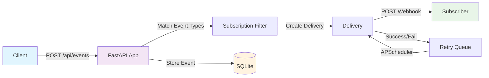

# Webhook Relay

一个轻量级的 Webhook 事件转发服务，接收事件并异步投递给所有匹配的订阅者，支持失败重试和签名验证。

[](https://www.python.org/)
[](https://fastapi.tiangolo.com/)
[](https://www.sqlalchemy.org/)
[](LICENSE)

## 架构概览



**流程说明：**
1. Client 发送事件到 `POST /api/events`
2. FastAPI 匹配订阅者的 `event_types`
3. 创建 Delivery 记录并存储到 SQLite
4. httpx 异步投递 Webhook 到订阅者
5. 失败时进入重试队列，APScheduler 定时扫描重试

## 核心特性

- **事件订阅** - 灵活的订阅管理，支持按事件类型过滤
- **异步投递** - 后台任务异步处理，不阻塞主请求
- **失败重试** - 指数退避策略（1min → 2min → 4min → 8min → 16min），最多 5 次
- **签名验证** - HMAC-SHA256 签名机制，确保投递安全性和完整性
- **API 认证** - 所有接口需要 API Key 认证
- **分页查询** - 支持投递记录的分页和状态过滤

## 技术栈

| 组件 | 技术 | 用途 |
|------|------|------|
| Web 框架 | FastAPI | 高性能异步 Web 框架 |
| ORM | SQLAlchemy 2.0 | 数据库映射（Mapped 声明式） |
| 数据库 | SQLite | 轻量级存储（可扩展至 PostgreSQL） |
| HTTP 客户端 | httpx | 异步 HTTP 请求 |
| 定时任务 | APScheduler | 后台重试调度 |
| 签名算法 | HMAC-SHA256 | Webhook 签名验证 |

## 快速开始

### 1. 克隆项目

```bash
git clone https://github.com/mushanruoshui/webhook-relay.git
cd webhook-relay
```

### 2. 创建虚拟环境

```bash
python -m venv .venv
source .venv/bin/activate  # Linux/Mac
# 或
.venv\Scripts\activate     # Windows
```

### 3. 安装依赖

```bash
pip install -r requirements.txt
```

### 4. 配置环境变量

创建 `.env` 文件：

```bash
# 必填：API 认证密钥
API_KEY=your-secret-api-key-here

# 可选：数据库路径（默认 sqlite:///./webhook_1.db）
DATABASE_URL=sqlite:///./webhook_1.db
```

### 5. 启动服务

```bash
# 开发模式（自动重载）
uvicorn app.main:app --reload --host 0.0.0.0 --port 8000

# 生产模式
uvicorn app.main:app --host 0.0.0.0 --port 8000 --workers 4
```

### 6. 访问 API 文档

打开浏览器访问：`http://localhost:8000/docs`

## API 接口

### 认证

所有 `/api/*` 端点需要在 Header 中携带 API Key：

```bash
X-API-Key: your-api-key
```

### 订阅管理

```bash
# 创建订阅
curl -X POST http://localhost:8000/api/subscriptions \
  -H "Content-Type: application/json" \
  -H "X-API-Key: your-api-key" \
  -d '{
    "url": "https://example.com/webhook",
    "secret": "your-webhook-secret",
    "event_types": ["order.created", "user.registered"],
    "description": "订单和用户事件订阅"
  }'

# 查询订阅列表
curl http://localhost:8000/api/subscriptions \
  -H "X-API-Key: your-api-key"
```

### 事件投递

```bash
# 创建事件（自动触发投递）
curl -X POST http://localhost:8000/api/events \
  -H "Content-Type: application/json" \
  -H "X-API-Key: your-api-key" \
  -d '{
    "event_type": "order.created",
    "payload": {
      "order_id": "ORD-20260901-001",
      "amount": 99.99,
      "user_id": "U1001"
    }
  }'

# 查询事件详情（含投递记录）
curl http://localhost:8000/api/events/1 \
  -H "X-API-Key: your-api-key"
```

### 投递记录

```bash
# 查询投递记录（支持分页和状态过滤）
curl "http://localhost:8000/api/deliveries?status=failed&limit=10&offset=0" \
  -H "X-API-Key: your-api-key"

# 手动触发重试
curl -X POST http://localhost:8000/api/deliveries/1/retry \
  -H "X-API-Key: your-api-key"
```

## 签名验证

Webhook 投递时，会在 Header 中携带签名信息：

```
X-Relay-Signature: t=1693574400,v1=abc123...
```

### 验证签名

```python
import hmac
import hashlib
import time

def verify_signature(payload_body: str, signature_header: str, secret: str) -> bool:
    """验证 Webhook 签名"""
    try:
        # 解析签名
        timestamp_str, signature = signature_header.split(",")
        timestamp = int(timestamp_str.split("=")[1])
        expected_signature = signature.split("=")[1]
        
        # 检查时间戳（5 分钟内有效）
        if abs(time.time() - timestamp) > 300:
            return False
        
        # 计算期望的签名
        signing_payload = f"{timestamp}.{payload_body}"
        expected = hmac.new(
            secret.encode(),
            signing_payload.encode(),
            hashlib.sha256
        ).hexdigest()
        
        # 使用 hmac.compare_digest 防时序攻击
        return hmac.compare_digest(expected, expected_signature)
    
    except (ValueError, IndexError):
        return False
```

## 数据模型

### Subscription（订阅）

| 字段 | 类型 | 说明 |
|------|------|------|
| id | Integer | 主键 |
| url | String(512) | 订阅地址 |
| secret | String(256) | 签名密钥 |
| event_types | JSON | 事件类型列表 |
| is_active | Boolean | 是否启用 |
| description | String(256) | 描述 |
| created_at | DateTime | 创建时间 |
| updated_at | DateTime | 更新时间 |

### Event（事件）

| 字段 | 类型 | 说明 |
|------|------|------|
| id | Integer | 主键 |
| event_type | String(64) | 事件类型 |
| payload | JSON | 事件数据 |
| created_at | DateTime | 创建时间 |

### Delivery（投递）

| 字段 | 类型 | 说明 |
|------|------|------|
| id | Integer | 主键 |
| event_id | Integer | 关联事件 ID |
| subscription_id | Integer | 关联订阅 ID |
| status | String(32) | 状态：pending/success/failed/retrying |
| attempt_count | Integer | 尝试次数 |
| response_code | Integer | HTTP 响应码 |
| error_message | String(512) | 错误信息 |
| max_attempts | Integer | 最大尝试次数（默认 5） |
| next_attempt_at | DateTime | 下次重试时间 |
| created_at | DateTime | 创建时间 |
| updated_at | DateTime | 更新时间 |

## 测试

```bash
# 运行测试
pytest tests/ -v

# 启动测试接收方（端口 9000）
python test_receiver.py
```

### 测试用例

```bash
# 创建订阅
curl -X POST http://localhost:8000/api/subscriptions \
  -H "Content-Type: application/json" \
  -H "X-API-Key: your-api-key" \
  -d '{
    "url": "http://localhost:9000/webhook",
    "secret": "test-secret-key",
    "event_types": ["test.event"]
  }'

# 发送测试事件
curl -X POST http://localhost:8000/api/events \
  -H "Content-Type: application/json" \
  -H "X-API-Key: your-api-key" \
  -d '{
    "event_type": "test.event",
    "payload": {"message": "Hello Webhook!"}
  }'
```

## 部署

### 生产环境部署（阿里云 ECS）

1. **服务器配置**
   ```bash
   # SSH 连接
   ssh deploy@your-server-ip
   
   # 克隆代码
   cd /opt
   git clone https://github.com/mushanruoshui/webhook-relay.git
   cd webhook-relay
   ```

2. **环境配置**
   ```bash
   # 创建虚拟环境
   python3 -m venv .venv
   source .venv/bin/activate
   pip install -r requirements.txt
   
   # 配置环境变量
   cp .env.example .env
   # 编辑 .env 填入 API_KEY
   ```

3. **Systemd 服务**
   ```bash
   sudo cp webhook-relay.service /etc/systemd/system/
   sudo systemctl daemon-reload
   sudo systemctl enable webhook-relay
   sudo systemctl start webhook-relay
   ```

4. **Nginx 反向代理**
   ```nginx
   server {
       listen 80;
       server_name your-domain.com;
       
       location / {
           proxy_pass http://127.0.0.1:8000;
           proxy_set_header Host $host;
           proxy_set_header X-Real-IP $remote_addr;
       }
   }
   ```

### Docker 部署（可选）

```bash
# 构建镜像
docker build -t webhook-relay .

# 运行容器
docker run -d \
  --name webhook-relay \
  -p 8000:8000 \
  -e API_KEY=your-api-key \
  -v $(pwd)/data:/app/data \
  webhook-relay
```

## 项目结构

```
webhook-relay/
├── app/
│   ├── __init__.py
│   ├── main.py            # FastAPI 入口，lifespan 管理
│   ├── models.py          # SQLAlchemy 数据模型
│   ├── schemas.py         # Pydantic 请求/响应 schema
│   ├── database.py        # 数据库引擎、会话工厂
│   ├── auth.py            # API Key 认证
│   ├── scheduler.py       # APScheduler 定时任务配置
│   ├── routers/
│   │   ├── __init__.py
│   │   ├── subscriptions.py  # 订阅 CRUD
│   │   ├── events.py         # 事件创建 + 查询
│   │   └── deliveries.py     # 投递查询 + 重试
│   └── services/
│       ├── __init__.py
│       ├── delivery.py    # 投递核心逻辑 + 签名计算
│       └── retry.py       # 扫描到期的重试投递
├── tests/                 # pytest 测试
│   ├── conftest.py        # 测试配置（隔离数据库）
│   ├── test_subscriptions.py
│   ├── test_events.py
│   └── test_deliveries.py
├── requirements.txt       # Python 依赖
├── .env.example           # 环境变量模板
├── .gitignore
└── README.md
```

## 配置说明

### 环境变量

| 变量 | 必填 | 说明 | 默认值 |
|------|------|------|--------|
| API_KEY | ✅ | API 认证密钥 | - |
| DATABASE_URL | ❌ | 数据库连接字符串 | `sqlite:///./webhook_1.db` |

### 重试策略

| 尝试次数 | 等待时间 | 累计等待 |
|----------|----------|----------|
| 1 | 1 分钟 | 1 分钟 |
| 2 | 2 分钟 | 3 分钟 |
| 3 | 4 分钟 | 7 分钟 |
| 4 | 8 分钟 | 15 分钟 |
| 5 | 16 分钟 | 31 分钟 |

## 扩展性

### 扩展建议

1. **数据库** - 迁移至 PostgreSQL/MySQL 支持高并发
2. **消息队列** - 引入 Redis/RabbitMQ 解耦投递任务
3. **监控** - 集成 Prometheus + Grafana 监控投递成功率
4. **Web UI** - 添加管理后台可视化订阅和投递状态
5. **限流** - 对订阅者 URL 实施速率限制

### 性能优化

- SQLite → PostgreSQL（高并发场景）
- 单进程 → 多 worker（CPU 密集型）
- 同步投递 → 异步投递（已实现）
- 文件存储 → 对象存储（大 payload 场景）

## 常见问题

### Q: 为什么选择 SQLite？

A: SQLite 适合轻量级服务和原型验证，支持单机部署。生产环境可轻松迁移至 PostgreSQL。

### Q: 如何扩展支持更多事件类型？

A: 事件类型是动态的，无需修改代码。创建订阅时指定 `event_types` 列表即可。

### Q: 重试失败后会怎样？

A: 达到最大重试次数（5 次）后，投递状态变为 `failed`，可通过 `/api/deliveries/{id}/retry` 手动触发重试。

## 许可证

MIT License

## 联系方式

- GitHub: [mushanruoshui](https://github.com/mushanruoshui)
- 项目地址: [webhook-relay](https://github.com/mushanruoshui/webhook-relay)

---

**如果这个项目对你有帮助，请给个 Star ⭐ 支持一下！**
