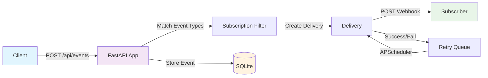

# Webhook Relay

一个轻量级的 Webhook 事件转发服务：接收事件，异步投递给所有匹配的订阅者，支持失败重试和签名验证。

[](https://www.python.org/)
[](https://docs.astral.sh/uv/)
[](https://fastapi.tiangolo.com/)
[](https://www.sqlalchemy.org/)
[](LICENSE)


## 架构概览



**流程说明：**

1. Client 发送事件到 `POST /api/events`
2. FastAPI 落库事件记录并立即返回 `202`，投递任务交给 `BackgroundTasks`
3. 后台任务匹配订阅者的 `event_types`，为每个匹配订阅创建一条 Delivery
4. 使用 httpx 向订阅者 URL 发起 `POST`（同步调用，超时 10 秒）
5. 投递失败时按指数退避写入 `next_attempt_at`，APScheduler 每 10 秒扫描到期任务并重试

## 核心特性

- **事件订阅** - 灵活的订阅管理，支持按事件类型过滤
- **后台任务投递** - 接收与投递解耦（`BackgroundTasks`），上游请求不被下游投递阻塞
- **失败重试** - 指数退避策略（1min → 2min → 4min → 8min → 16min），最多 5 次
- **签名验证** - HMAC-SHA256 签名机制，确保投递安全性和完整性
- **API 认证** - 所有接口需要 API Key 认证
- **分页查询** - 支持投递记录的分页和状态过滤
- **复合索引** - 针对重试扫描的「等值 + 范围」查询条件设计联合索引，并提供幂等的存量库迁移脚本

## 技术栈

| 组件 | 技术 | 用途 |
|------|------|------|
| Web 框架 | FastAPI | 异步 Web 框架（本项目路由使用同步 `def`） |
| ORM | SQLAlchemy 2.0 | 数据库映射（Mapped 声明式） |
| 数据库 | SQLite | 轻量级存储（可扩展至 PostgreSQL / MySQL） |
| HTTP 客户端 | httpx | 投递 Webhook 请求（同步调用） |
| 定时任务 | APScheduler | 后台重试调度（BackgroundScheduler） |
| 签名算法 | HMAC-SHA256 | Webhook 签名验证 |
| 依赖管理 | uv | 声明式依赖 + 全平台锁文件，管理 Python 版本与虚拟环境 |

## 快速开始

### 1. 克隆项目

```bash
git clone https://github.com/mushanruoshui/webhook-relay.git
cd webhook-relay
```

### 2. 安装 uv

依赖由 [uv](https://docs.astral.sh/uv/) 管理：`pyproject.toml` 声明依赖，`uv.lock` 锁定完整依赖图，`.python-version` 固定 Python 版本。

```bash
# macOS / Linux
curl -LsSf https://astral.sh/uv/install.sh | sh

# Windows（PowerShell）
powershell -ExecutionPolicy ByPass -c "irm https://astral.sh/uv/install.ps1 | iex"

# 或已装 pip 的环境（内网/受限环境适用）
pip install uv
```

### 3. 同步依赖（自动创建 .venv）

```bash
uv sync            # 运行期 + 开发依赖（含 pytest）→ 生成/更新 .venv
uv sync --no-dev   # 只装运行期依赖（生产/容器）
```

`.python-version` 写的 `3.11` 会让 uv 自动准备对应解释器，**不需要手工装 Python**；环境已存在时 `uv sync` 会就地修正，不必先删 `.venv`。

### 4. 配置环境变量

创建 `.env` 文件：

```bash
# 必填：API 认证密钥（缺失时服务拒绝启动）
API_KEY=your-secret-api-key-here

# 可选：数据库路径（默认 sqlite:///./webhook_1.db）
DATABASE_URL=sqlite:///./webhook_1.db
```

### 5. 启动服务

```bash
# 开发模式（自动重载）
uv run uvicorn app.main:app --reload --host 0.0.0.0 --port 8000

# 生产模式
uv run uvicorn app.main:app --host 0.0.0.0 --port 8000 --workers 4
```

> ⚠️ `--workers 4` 目前**不安全**，会导致重复投递，原因见「设计边界」第 1 条。单机部署请使用默认的单 worker。

### 6. 访问 API 文档

打开浏览器访问：`http://localhost:8000/docs`

## API 接口

### 认证

所有 `/api/*` 端点需要在 Header 中携带 API Key：

```bash
X-API-Key: your-api-key
```

缺少该 Header 时返回 `422`（FastAPI 对必填 Header 的标准行为）；Header 存在但不匹配时返回 `401`。

### 订阅管理

```bash
# 创建订阅（成功后返回 201）
curl -X POST http://localhost:8000/api/subscriptions \
  -H "Content-Type: application/json" \
  -H "X-API-Key: your-api-key" \
  -d '{
    "url": "https://example.com/webhook",
    "secret": "your-webhook-secret",
    "event_types": ["order.created", "user.registered"],
    "description": "订单和用户事件订阅"
  }'

# 查询订阅列表
curl http://localhost:8000/api/subscriptions \
  -H "X-API-Key: your-api-key"

# 更新订阅（仅传需要修改的字段）
curl -X PUT http://localhost:8000/api/subscriptions/1 \
  -H "Content-Type: application/json" \
  -H "X-API-Key: your-api-key" \
  -d '{"is_active": false}'

# 删除订阅（成功返回 204）
curl -X DELETE http://localhost:8000/api/subscriptions/1 \
  -H "X-API-Key: your-api-key"
```

### 事件投递

```bash
# 创建事件（返回 202，投递在后台进行）
curl -X POST http://localhost:8000/api/events \
  -H "Content-Type: application/json" \
  -H "X-API-Key: your-api-key" \
  -d '{
    "event_type": "order.created",
    "payload": {
      "order_id": "ORD-20260901-001",
      "amount": 99.99,
      "user_id": "U1001"
    }
  }'

# 查询事件列表
curl http://localhost:8000/api/events \
  -H "X-API-Key: your-api-key"

# 查询事件详情（含关联投递记录）
curl http://localhost:8000/api/events/1 \
  -H "X-API-Key: your-api-key"
```

### 投递记录

```bash
# 查询投递记录（支持分页和状态过滤）
curl "http://localhost:8000/api/deliveries?status=failed&limit=10&offset=0" \
  -H "X-API-Key: your-api-key"

# 手动触发重试：批量扫描所有到期的 retrying 投递
curl -X POST http://localhost:8000/api/deliveries/retry \
  -H "X-API-Key: your-api-key"
```

> 手动重试接口为**批量**语义（无 `id` 参数），返回值形如 `{"retried": 3}`，表示本次实际重试的条数。

## 投递状态机

| 状态 | 含义 | 何时进入 |
|------|------|----------|
| `pending` | 已创建，尚未尝试 | 创建 Delivery 时的初始值 |
| `delivered` | 投递成功（下游返回 < 400） | HTTP 响应码 < 400 |
| `retrying` | 投递失败且未达上限，已排入重试 | 失败且 `attempt_count < max_attempts` |
| `failed` | 达到最大尝试次数 | `attempt_count >= max_attempts` |

> 注意：成功状态是 **`delivered`**（不是 `success`），按状态过滤时请使用 `delivered`。

## 签名验证

投递时会在 Header 中携带签名信息：

```
X-Relay-Signature: t=1693574400,v1=abc123...
```

### 验证签名

```python
import hmac
import hashlib
import time

def verify_signature(payload_body: str, signature_header: str, secret: str) -> bool:
    """验证 Webhook 签名"""
    try:
        # 解析签名
        timestamp_str, signature = signature_header.split(",")
        timestamp = int(timestamp_str.split("=")[1])
        expected_signature = signature.split("=")[1]

        # 检查时间戳（5 分钟内有效，防重放）
        if abs(time.time() - timestamp) > 300:
            return False

        # 计算期望的签名
        signing_payload = f"{timestamp}.{payload_body}"
        expected = hmac.new(
            secret.encode(),
            signing_payload.encode(),
            hashlib.sha256
        ).hexdigest()

        # 使用 hmac.compare_digest 防时序攻击
        return hmac.compare_digest(expected, expected_signature)

    except (ValueError, IndexError):
        return False
```

**要点**：`signing_payload` 是 `"{timestamp}.{payload_json}"`，其中 `payload_json` 必须与请求体的原始字节一致（服务端使用 `json.dumps` 的默认分隔符）。接收方应使用原始请求体而非重新序列化的结果来验签。

## 数据模型

### Subscription（订阅）

| 字段 | 类型 | 说明 |
|------|------|------|
| id | Integer | 主键 |
| url | String(512) | 订阅地址 |
| secret | String(256) | 签名密钥 |
| event_types | JSON | 事件类型列表 |
| is_active | Boolean | 是否启用 |
| description | String(256) | 描述 |
| created_at | DateTime | 创建时间 |
| updated_at | DateTime | 更新时间 |

### Event（事件）

| 字段 | 类型 | 说明 |
|------|------|------|
| id | Integer | 主键 |
| event_type | String(64) | 事件类型（索引） |
| payload | JSON | 事件数据 |
| created_at | DateTime | 创建时间 |

### Delivery（投递）

| 字段 | 类型 | 说明 |
|------|------|------|
| id | Integer | 主键 |
| event_id | Integer | 关联事件 ID（外键，索引） |
| subscription_id | Integer | 关联订阅 ID（外键，索引） |
| status | String(32) | 状态：pending / delivered / retrying / failed（索引） |
| attempt_count | Integer | 已尝试次数 |
| response_code | Integer | 下游 HTTP 响应码 |
| error_message | String(512) | 错误信息（截断至 512 字符） |
| max_attempts | Integer | 最大尝试次数（默认 5） |
| next_attempt_at | DateTime | 下次重试时间 |
| created_at | DateTime | 创建时间 |
| updated_at | DateTime | 更新时间 |

**联合索引**：`Index("ix_deliveries_status_next_attempt", "status", "next_attempt_at")`

`retry.py` 的重试扫描条件是「`status` 等值 + `next_attempt_at` 范围」，单列索引只能命中其中一个条件，另一个会退化为回表过滤。联合索引的列序遵循**等值列在前、范围列在后**的原则（范围列之后的列无法再利用索引有序性）。

`status` 的单列索引保留，因为投递列表的 `WHERE status = ?` 与 `COUNT(*)` 仍只用到它；`next_attempt_at` 的单列索引已移除，其用途被联合索引的最左前缀完全覆盖——索引会拖慢写入，而 `deliveries` 是高频写表（每次投递都会 UPDATE）。

## 数据库迁移

`Base.metadata.create_all()` **只创建缺失的表，不会为已存在的表补建索引**，因此已有数据的库不会自动获得上述联合索引。

`scripts/add_composite_index.py` 用于给存量库补建索引，脚本是**幂等**的（`CREATE INDEX IF NOT EXISTS`），并会打印 `EXPLAIN QUERY PLAN` 输出以便确认索引确实被命中：

```bash
uv run python -m scripts.add_composite_index
```

输出示例：

```
目标库: sqlite:///./webhook_1.db  (dialect=sqlite)
已创建索引 ix_deliveries_status_next_attempt (status, next_attempt_at)
EXPLAIN QUERY PLAN:
    SEARCH deliveries USING INDEX ix_deliveries_status_next_attempt (status=? AND next_attempt_at<?)
```

> 这个脚本是为了绕过「ORM 建表工具不做迁移」而手写的补丁。生产环境的表结构演进应当使用 **Alembic**，而不是 `create_all()` 加手写 DDL——这是本项目已知的工程债之一。

## 测试

```bash
# 运行测试
uv run pytest tests/ -v

# 启动测试接收方（端口 9000）
uv run python test_receiver.py
```

`tests/conftest.py` 在 **import app 之前**通过环境变量把数据库指向独立的 `test.db` 并固定 `API_KEY`，因此测试不会污染业务库 `webhook_1.db`；每个测试函数前重建全部表，保证用例之间互不干扰。

### 测试用例

```bash
# 创建订阅
curl -X POST http://localhost:8000/api/subscriptions \
  -H "Content-Type: application/json" \
  -H "X-API-Key: your-api-key" \
  -d '{
    "url": "http://localhost:9000/webhook",
    "secret": "test-secret-key",
    "event_types": ["test.event"]
  }'

# 发送测试事件
curl -X POST http://localhost:8000/api/events \
  -H "Content-Type: application/json" \
  -H "X-API-Key: your-api-key" \
  -d '{
    "event_type": "test.event",
    "payload": {"message": "Hello Webhook!"}
  }'
```

## 部署

### 生产环境部署（阿里云 ECS）

1. **服务器配置**
   ```bash
   # SSH 连接
   ssh deploy@your-server-ip

   # 克隆代码
   cd /opt
   git clone https://github.com/mushanruoshui/webhook-relay.git
   cd webhook-relay
   ```

2. **环境配置**
   ```bash
   # 安装 uv（该服务器出网受限，用 pip 走已验证可用的镜像源）
   python3 -m pip install uv

   # 按 uv.lock 创建 .venv 并安装运行期依赖，不做重新解析
   uv sync --frozen --no-dev

   # 如需在服务器上跑测试，去掉 --no-dev
   # uv sync --frozen

   # 配置环境变量
   cp .env.example .env
   # 编辑 .env 填入 API_KEY
   ```

3. **Systemd 服务**
   ```bash
   sudo cp webhook-relay.service /etc/systemd/system/
   sudo systemctl daemon-reload
   sudo systemctl enable webhook-relay
   sudo systemctl start webhook-relay

   # 查看状态与日志
   sudo systemctl status webhook-relay
   sudo journalctl -u webhook-relay -n 100
   ```

4. **Nginx 反向代理**
   ```nginx
   server {
       listen 80;
       server_name your-domain.com;

       location / {
           proxy_pass http://127.0.0.1:8000;
           proxy_set_header Host $host;
           proxy_set_header X-Real-IP $remote_addr;
       }
   }
   ```

### Docker 部署（本地验证可用）

```bash
# 构建镜像
docker build --platform linux/amd64 -t webhook-relay .
# 首次构建会拉取 ghcr.io/astral-sh/uv:0.11.29（约 20MB）与 python:3.11-slim

# 用 compose 启动（读取 .env 中的 API_KEY）
docker compose up -d

# 验证
curl http://localhost:8000/

# 查看日志、进入容器
docker compose logs -f
docker compose exec app sh

# 停止
docker compose down
```

Dockerfile 采用两段式构建：先 `COPY pyproject.toml uv.lock` 并执行 `uv sync --frozen --no-dev`，再 `COPY . .` 复制源码。因此仅修改业务代码时不会触发依赖重装，镜像层缓存得以命中。

`uv` 二进制通过多阶段 `COPY --from=ghcr.io/astral-sh/uv:0.11.29` 从官方镜像取出，镜像内**不含 pip**；业务依赖全部来自 `uv.lock`，`--frozen` 保证构建机上的解析结果与仓库一致。`UV_PYTHON_DOWNLOADS=never` 则确保版本不匹配时构建立刻失败，而不是静默下载一个解释器。

### 已知的部署限制

项目曾在一台无法访问 Docker Hub 及国内公共镜像源的云服务器上尝试容器部署，`docker pull` 均以 TLS 超时或连接超时失败。采用的降级方案是**本地拉取镜像后离线搬运**：

```bash
# 本地保存
docker save <镜像名> | gzip > <镜像名>.tar.gz

# 传输
scp <镜像名>.tar.gz deploy@your-server-ip:~/

# 服务器加载
gunzip -c <镜像名>.tar.gz | docker load
```

## 设计边界（已知问题）

1. **多 worker 会重复投递。** `scheduler.py` 在每个进程内启动一个 APScheduler，若以 `--workers N` 启动，会有 N 个调度器每 10 秒扫描同一批到期任务，导致同一条 Webhook 被重复投递。当前定位为**单机单进程**。水平扩展需要把调度器抽成独立进程，或迁移到支持 `SELECT ... FOR UPDATE SKIP LOCKED` 的数据库做任务抢占。

2. **投递语义是 at-least-once，不是 exactly-once。** 重复由接收方结合签名时间窗与业务幂等键消化。

3. **投递事务包含外部 HTTP 请求。** `_attempt_delivery` 在持有数据库会话的情况下发起 `httpx.post`（超时 10 秒），网络慢时会长时间占用连接与写锁。更合理的做法是先提交投递记录，再发起请求，返回后开新事务更新状态。

4. **`pending` 状态缺少兜底。** 若进程在后台任务执行前崩溃，记录会停留在 `pending`，而重试扫描只处理 `retrying`。需要增加一个扫描滞留 `pending` 的补偿任务。

5. **订阅匹配在 Python 侧完成。** 当前实现会取出全部启用订阅，再用 `in` 判断事件类型是否命中；订阅量增大后应下推到数据库查询（如关联表 + 索引）或引入消息队列做解耦。

6. **`httpx` 默认 `trust_env=True`。** 若运行环境存在 `HTTP_PROXY` 等系统代理，投递请求会走代理，可能导致内网订阅地址投递失败或收到代理返回的 502。生产环境建议显式设置 `trust_env=False`，或为内网地址配置 `NO_PROXY`。

7. **数据持久化依赖 SQLite 单文件。** 多实例部署需迁移到 PostgreSQL / MySQL。

## 项目结构

```
webhook-relay/
├── app/
│   ├── __init__.py
│   ├── main.py            # FastAPI 入口，lifespan 管理调度器启停
│   ├── models.py          # SQLAlchemy 数据模型
│   ├── schemas.py         # Pydantic 请求/响应 schema
│   ├── database.py        # 数据库引擎、会话工厂
│   ├── auth.py            # API Key 认证
│   ├── scheduler.py       # APScheduler 定时任务配置
│   ├── routers/
│   │   ├── __init__.py
│   │   ├── subscriptions.py  # 订阅 CRUD
│   │   ├── events.py         # 事件创建 + 查询
│   │   └── deliveries.py     # 投递查询 + 重试
│   └── services/
│       ├── __init__.py
│       ├── delivery.py    # 投递核心逻辑 + 签名计算
│       └── retry.py       # 扫描到期的重试投递
├── scripts/
│   └── add_composite_index.py  # 为存量库补建联合索引（幂等）
├── tests/                 # pytest 测试
│   ├── conftest.py        # 测试配置（隔离数据库）
│   ├── test_subscriptions.py
│   ├── test_events.py
│   └── test_deliveries.py
├── Dockerfile
├── docker-compose.yml
├── pyproject.toml         # 依赖声明（PEP 621）+ dev 依赖组
├── uv.lock                # 全平台通用锁文件（提交进仓库）
├── .python-version        # 统一的 Python 版本（3.11）
├── .env.example           # 环境变量模板
├── .gitignore
└── README.md
```

## 配置说明

### 环境变量

| 变量 | 必填 | 说明 | 默认值 |
|------|------|------|--------|
| API_KEY | ✅ | API 认证密钥（缺失时服务拒绝启动） | - |
| DATABASE_URL | ❌ | 数据库连接字符串 | `sqlite:///./webhook_1.db` |

> 使用 Docker Compose 时，`DATABASE_URL` 需显式指向容器内的挂载目录（`sqlite:////app/data/webhook_1.db`），否则 `volumes` 挂载的数据目录不会真正承载数据库文件。注意 SQLAlchemy 的 SQLite URL 中**三个斜杠表示相对路径，四个斜杠表示绝对路径**。

### 重试策略

第 `n` 次尝试失败后，等待 `60 × 2^(n-1)` 秒：

| 尝试次数 | 等待时间 | 累计等待 |
|----------|----------|----------|
| 1 | 1 分钟 | 1 分钟 |
| 2 | 2 分钟 | 3 分钟 |
| 3 | 4 分钟 | 7 分钟 |
| 4 | 8 分钟 | 15 分钟 |
| 5 | 16 分钟 | 31 分钟 |

扫描周期为 10 秒，因此实际重试时刻会有最多约 10 秒的延迟。

## 扩展性

### 扩展建议

1. **数据库** - 迁移至 PostgreSQL / MySQL 支持更高并发写入
2. **消息队列** - 引入 Redis / RabbitMQ 解耦投递任务，替代进程内 `BackgroundTasks`
3. **调度器** - 抽成独立 worker 进程，配合任务抢占解决多副本重复投递
4. **迁移工具** - 引入 Alembic 管理表结构演进，取代 `create_all()` + 手写 DDL
5. **监控** - 集成 Prometheus + Grafana 监控投递成功率与重试堆积
6. **限流与安全** - 对订阅者 URL 实施速率限制，并校验 URL 防止 SSRF
7. **密钥管理** - 订阅 `secret` 目前明文存储，应改为加密存储或仅存哈希

### 性能优化

- SQLite → PostgreSQL（高并发场景）
- 单进程 → 多 worker（需先解决设计边界第 1 条）
- 同步投递 → 异步投递（改用 `httpx.AsyncClient` + `AsyncIOScheduler`）
- 逐条提交 → 批量提交（当前 `deliver_event` 中每条 Delivery 都会 commit 一次）
- 订阅匹配下推到数据库，避免全表载入后在 Python 侧过滤

## 常见问题

### Q: 为什么选择 SQLite？

A: 该服务的定位是轻量级单机转发，数据量和写入并发都不需要独立数据库进程，SQLite 可以省掉一整套运维成本。代价是写入串行化、不适合多实例部署——需要横向扩展时应迁移至 PostgreSQL 或 MySQL，SQLAlchemy 已把差异收敛在 `DATABASE_URL` 与 `create_engine` 的参数上。

### Q: 如何扩展支持更多事件类型？

A: 事件类型是动态的，无需修改代码。创建订阅时指定 `event_types` 列表即可。

### Q: 重试失败后会怎样？

A: 达到最大尝试次数（默认 5 次）后，投递状态变为 `failed`，`next_attempt_at` 清空，不再被自动扫描。可通过 `POST /api/deliveries/retry` 手动触发重试（批量语义，仅重试 `retrying` 且已到期的记录）。

### Q: 为什么用 BackgroundTasks 而不是 Celery？

A: 当前规模下 `BackgroundTasks` 零额外依赖、部署简单，能满足「不阻塞上游请求」这一核心诉求。代价是任务与 Web 进程同生命周期：进程崩溃时在途任务丢失，且无法跨机器分发。量级上来后应换成 Celery + Redis 之类的独立任务队列。

## 许可证

MIT License
